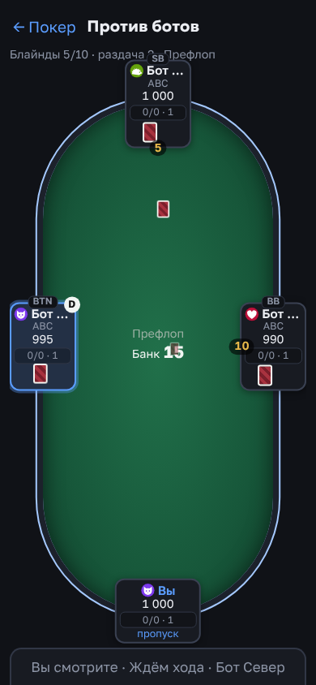
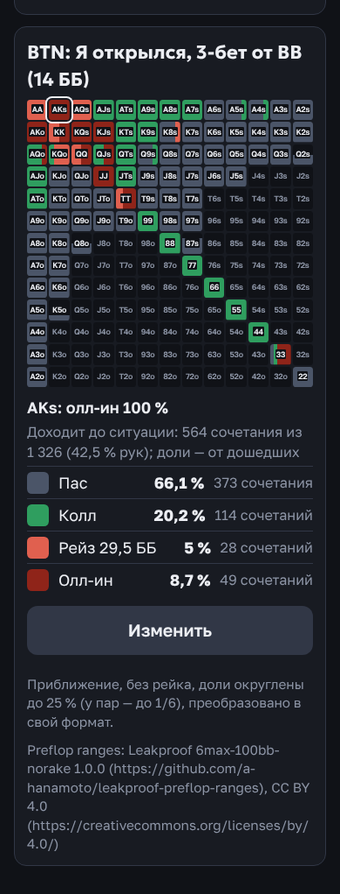
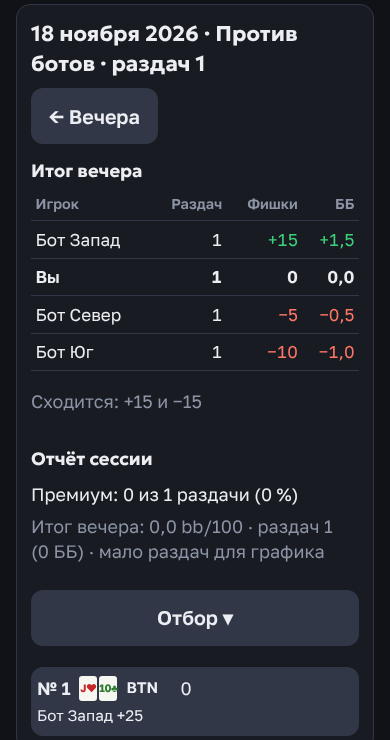
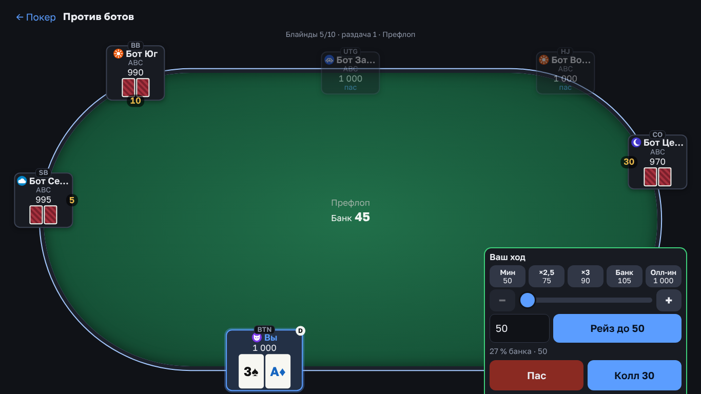
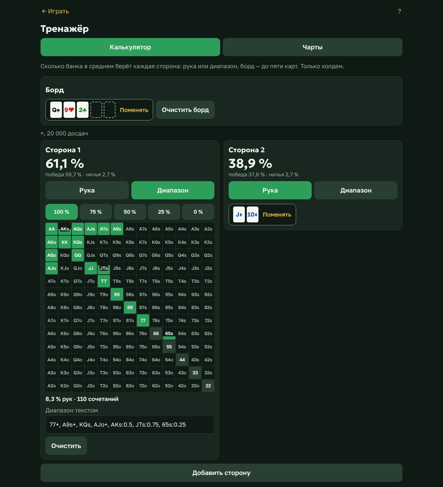

# Фишки

Покер-клуб для компании друзей: столы против ботов, комнаты по ссылке на каждом своём телефоне, казино, тренажёр и учёт покерных вечеров с расчётом «кто кому». Деньги приложение не переводит — только считает.

<p align="center">
  
  &nbsp;&nbsp;
  
  &nbsp;&nbsp;
  
</p>
<p align="center">
  
</p>
<p align="center">
  
</p>
<p align="center"><sub>Данные на снимках выдуманные.</sub></p>

## Что умеет

- **Играть:** комната по ссылке (у каждого карты на своём телефоне), стол на одном телефоне, игра против ботов без сети (от одного до пяти), казино. Холдем, омаха, шорт-дек, свои игры.
- **Тренажёр:** калькулятор шансов (рука или диапазон против руки или диапазона, до шести сторон) и префлоп-чарты 6-макс.
- **Учёт вечера:** закупы, докупы и выходы, итог в фишках и рублях, проверка, что игра сходится, минимум переводов «кто кому», выгрузка текстом для чата.
- **История и разбор:** история раздач с отбором и выгрузкой, итоги прошлых вечеров, HUD (статистика игроков и чтение ботов).
- **Облик:** три гаммы — «Ночь», «Клуб», «День». Ставится на экран телефона как приложение (PWA), учёт работает без сети.
- **Синхронизация** между своими устройствами через приватный репозиторий владельца на GitHub.

## Где открыть

- Сайт: https://goigolden88.github.io/Magic_Fishki/
- Сервер комнат (Cloudflare Worker): https://fishki-poker.goigolden88.workers.dev/ — свой сервер можно поднять по [инструкции](docs/Свой%20сервер%20покера.md).

## Источники данных

Встроенные префлоп-чарты — набор [Leakproof](https://github.com/a-hanamoto/leakproof-preflop-ranges) `6max-100bb-norake` 1.0.0, лицензия [CC BY 4.0](https://creativecommons.org/licenses/by/4.0/); преобразован в свой формат, это приближение без рейка.

## Стек

Vite, React, TypeScript (`strict`), IndexedDB, PWA, Vitest; сервер комнат — Cloudflare Workers (Durable Objects).

## Локально

```
npm ci
npm run dev
npm test
npm run build
```

Полный `npm test` идёт минуты (прогоны ботов). Устройство и решения — в [`docs/`](docs/).

## Как сделано

Сделано конвейером агентов «Штаб»: https://github.com/goigolden88/Shtab

## Лицензия

MIT, см. [LICENSE](LICENSE).
